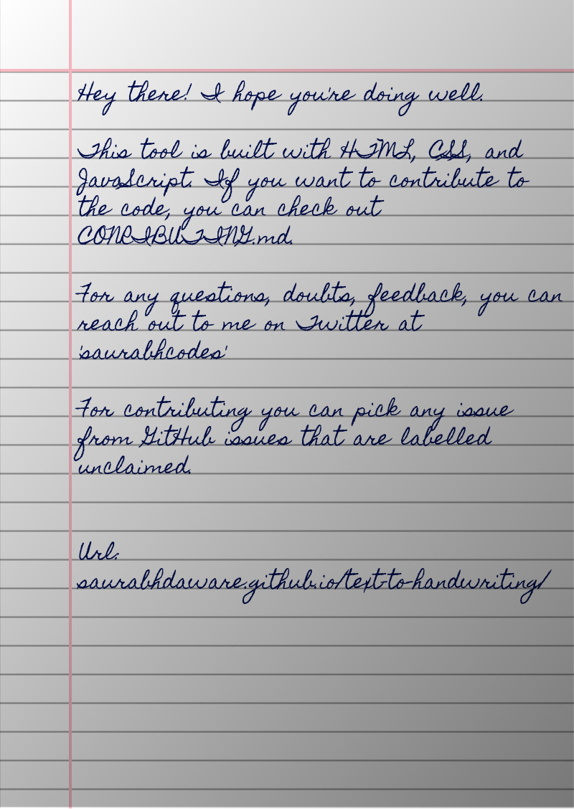

# HAPPY TO EXAM

**A handwriting-style page generator by IaEmon.**

Write or paste your notes, customize the page and handwriting, then export
your finished pages as images or a PDF.

## ✨ New features in this version

- **Mobile scan effects (Effects dropdown):** Trapezoid (Light / Medium / Strong), Phone Photo, Phone Scan, Tilted Phone Photo and Random Phone Capture, with choice of perspective direction and desk background.
- **Page colour:** white, cream, notepad yellow, light blue/green/pink/grey or any custom colour.
- **Header info:** name, department, batch and roll are written above the top margin line (all pages or first page only).
- **Scanner watermark (optional):** small scan-style watermark with editable text and position.

## 🌠 Output

Bye!
Have fun 🦄
